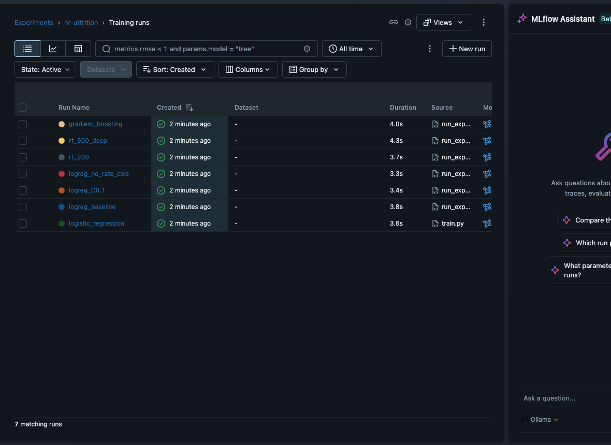

# HR Attrition - MLOps pipeline

Predicts whether an employee will leave the company (IBM HR Analytics dataset) and wraps the model in the pieces you need to run it in production: data versioning with DVC, config-driven training, MLflow experiment tracking, a pytest suite, a GitHub Actions pipeline and drift monitoring with Evidently.

The model itself is simple (logistic regression / random forest / gradient boosting from scikit-learn). The point of the project is everything around it.

## Dataset

IBM HR Analytics Employee Attrition & Performance - the same data as the Kaggle dataset, downloaded from IBM's repo [here](https://github.com/IBM/employee-attrition-aif360/blob/master/data/emp_attrition.csv).

- 1470 employees, 34 features (26 numeric, 8 categorical), target is `Attrition` (Yes/No), about 16% positives
- the original file has no missing values, so `scripts/make_dataset.py` blanks out 3-5% of the cells in six columns (MonthlyIncome, TotalWorkingYears, DistanceFromHome, EnvironmentSatisfaction, BusinessTravel, MaritalStatus) with a fixed seed
- `EmployeeCount`, `StandardHours`, `Over18` are constant and `EmployeeNumber` is an id, so they get dropped (see `drop_columns` in the config)

The CSV is tracked with DVC and is not in git. The DVC remote is a local folder `dvc-storage/` that lives inside the repo, so `dvc pull` works after cloning (and in CI) without any cloud credentials.

## Project layout

```
configs/
  config.yaml            paths, model type + hyperparameters, thresholds, mlflow settings
  experiments.yaml       the 6 experiment configs run by run_experiments.py
data/raw/hr_attrition.csv.dvc   DVC pointer file
src/
  data.py                load the csv, read the data version from the .dvc file
  preprocess.py          cleaning, imputation + encoding, train/test split
  train.py               trains the model, logs to mlflow, checks thresholds
  evaluate.py            metrics and threshold checks
  run_experiments.py     runs every experiment in experiments.yaml
  compare_experiments.py mlflow.search_runs() -> best run
  monitor_drift.py       evidently drift report
tests/                   unit, data validation and model tests
scripts/make_dataset.py  how the dataset with missing values was made
.github/workflows/ml-pipeline.yml
MONITORING.md            drift analysis
```

## Setup

Needs Python 3.12.

```bash
git clone https://github.com/Priti0427/hr-attrition-mlops.git
cd hr-attrition-mlops
python3.12 -m venv .venv
source .venv/bin/activate
pip install -r requirements.txt
dvc pull
```

## Training

```bash
python -m src.train --config configs/config.yaml
```

Everything (paths, model, hyperparameters, thresholds) comes from `configs/config.yaml`. The script

1. loads and cleans the data and does a stratified 80/20 split
2. fits a sklearn pipeline (median / most-frequent imputation, scaling, one-hot encoding, model)
3. logs the hyperparameters, the DVC md5 of the dataset, the test metrics and the model (`mlflow.sklearn.log_model`) to MLflow
4. saves `models/model.joblib` and `reports/metrics.json`
5. exits with code 1 if ROC AUC < 0.75, F1 < 0.40 or recall < 0.50

Recall has its own threshold because missing a leaver costs more than a false alarm, and gradient boosting for example gets a good ROC AUC while catching very few leavers.

## Experiments

```bash
python -m src.run_experiments        # runs all 6 configs in configs/experiments.yaml
python -m src.compare_experiments    # ranks the runs, prints the best one
mlflow ui --backend-store-uri sqlite:///mlflow.db
```

Results on the 294 row test set (full table in [reports/experiment_comparison.md](reports/experiment_comparison.md)):

| run | model | ROC AUC | F1 | recall | passed thresholds |
|---|---|---|---|---|---|
| logreg_no_rate_cols | logistic regression, without DailyRate/HourlyRate/MonthlyRate | **0.814** | 0.492 | 0.681 | yes |
| gradient_boosting | 300 trees, lr 0.05, depth 3 | 0.814 | 0.394 | 0.277 | no |
| logreg_C0.1 | logistic regression, C=0.1 | 0.811 | 0.500 | 0.681 | yes |
| logreg_baseline | logistic regression, C=1.0 | 0.803 | 0.462 | 0.638 | yes |
| rf_500_deep | random forest, 500 trees, depth 14 | 0.793 | 0.182 | 0.106 | no |
| rf_200 | random forest, 200 trees, depth 8 | 0.784 | 0.519 | 0.574 | yes |



Logistic regression with `class_weight=balanced` does best overall. Dropping the three "rate" columns helped a little, they seem to be mostly noise. Gradient boosting has the same ROC AUC but almost no recall at a 0.5 cutoff because it isn't class weighted, and the deep random forest with no leaf-size limit overfits and barely predicts any leavers (recall 0.11).

## Tests

```bash
pytest tests/ -v
```

- `test_preprocess.py` - unit tests: imputation of numeric and categorical missing values, one-hot encoding, unseen categories, the input dataframe isn't modified, errors on bad input
- `test_data.py` - data validation on the real csv: expected columns, target is only Yes/No, numeric ranges, missing values present but limited
- `test_model.py` - trains on a 500 row sample: prediction type/shape, minimum ROC AUC and recall on the test split, all model types train

The data and model tests are skipped with a message if `dvc pull` hasn't been run.

## CI

`.github/workflows/ml-pipeline.yml` runs on pushes and pull requests to `main`:

- **test** - install, `dvc pull`, `pytest tests/ -v`
- **train** (needs test) - install, `dvc pull`, `python -m src.train`. Fails if the script exits with 1 because a metric is under its threshold. The model and metrics are uploaded as an artifact.

## Drift monitoring

```bash
python -m src.monitor_drift              # simulated production data, exits with 1
python -m src.monitor_drift --no-drift   # untouched holdout, exits with 0
python -m src.monitor_drift --threshold 0.4
```

The training split is the reference and the test split plays the role of production data. By default `simulate_drift()` shifts it to look like a year has passed (pay rise, older workforce, office move, more overtime and travel). Evidently runs a drift test on every feature, the script prints which ones drifted and the overall share, saves `reports/drift_report_<scenario>.html`, and exits with 1 if the share is over `drift.share_threshold` (25%) in the config.

The analysis is in [MONITORING.md](MONITORING.md).
